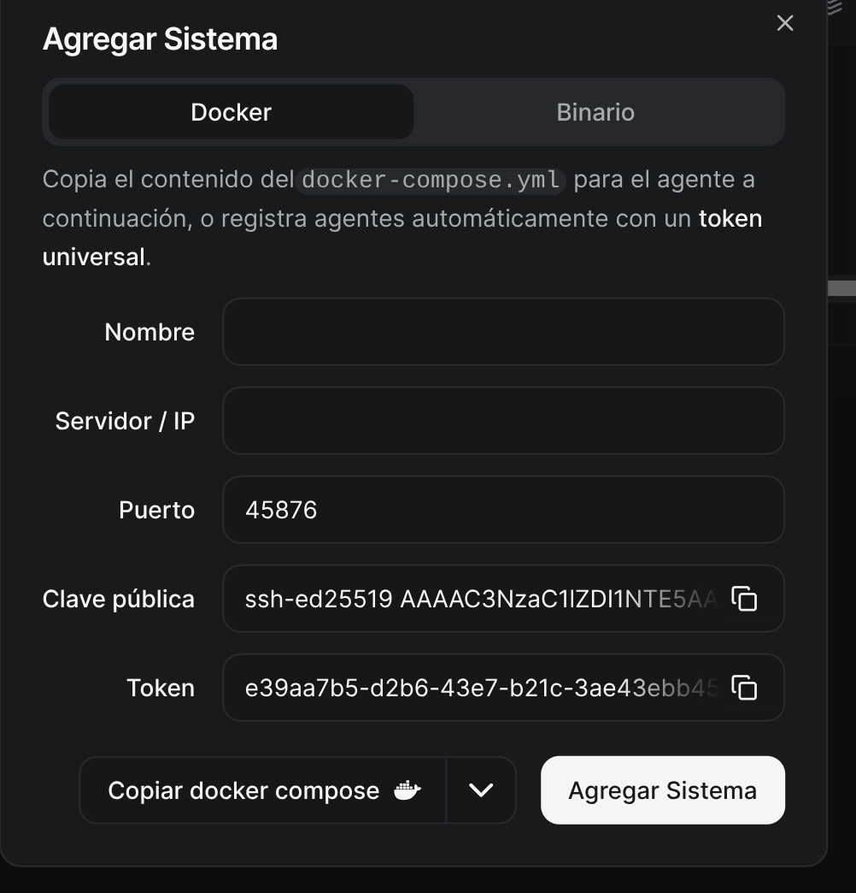

# Beszel: Setup

Lightweight server/container monitoring: a Hub (the web UI) and an Agent (reports
metrics back to it). This folder's `docker-compose.yml` runs both, with the Agent
watching the same host the Hub itself runs on, over a shared unix socket instead of
the network:

```text
                 beszel-web (Hub)
                  │              ▲
                  │ ./socket     │ reads metrics
                  ▼              │
             beszel.sock ────────┘
                  ▲
                  │ LISTEN=/beszel_socket/beszel.sock
                  │
              beszel-agent
                  │
                  ▼
     /var/run/docker.sock (ro)
          │           │           │
          ▼           ▼           ▼
       Stack 1     Stack 2     Stack 3
```

## Why this needs a 2-pass deploy

`beszel-agent` needs a `TOKEN` and a public `KEY` to authenticate to the Hub
(`BESZEL_AGENT_TOKEN` / `BESZEL_AGENT_KEY`). Unlike this repo's other secrets, these
can't be generated ahead of time with `openssl rand`: the Hub itself mints them, and
only once it's already running and you've asked it (via its web UI) to create them.
So:

1. **Deploy once** with the `changeme` dummy values. `beszel-web` comes up fine,
   `beszel-agent` starts but fails to authenticate, that's expected.
2. Open the Hub's web UI (`http://<host>:<BESZEL_WEB_HTTP>`, `6001` by this repo's
   port convention) and create the admin account on first visit.
3. Click **"Add System"** (top right). You get a dialog like this:

   

   Fill it in for the **socket** connection (not the network/token-only one the
   defaults suggest):
   - **Nombre / Name**: anything, e.g. this host's name.
   - **Servidor / IP**: literally `/beszel_socket/beszel.sock`, not an actual
     IP, that's the shared socket path from the diagram above.
   - **Puerto / Port**: leave the default (`45876`), unused in socket mode.
   - **Clave pública / Public Key** and **Token**: already generated for you,
     copy both.
4. On the VPS, put those two values into
   `/etc/srv-kube/host/<host-name>/.env-secrets.local`:
   ```
   BESZEL_AGENT_KEY=ssh-ed25519 AAAAC3Nza... (the full value from the dialog)
   BESZEL_AGENT_TOKEN=e39aa7b5-d2b6-43e7-... (the full value from the dialog)
   ```
5. **Deploy again** so `beszel-agent` picks up the real values and connects.
6. Back in that same "Add System" dialog (same Name/Server/Port as step 3), click
   **"Agregar Sistema" / "Add System"** again to finish pairing. It should turn
   green. If it turns red instead:
   ```bash
   docker logs beszel-agent --tail 50
   ```

## Notes

- `beszel-agent` runs with `network_mode: host` (for accurate host-level stats like
  network throughput), but only ever serves the unix socket, never a TCP port, so
  there's nothing to open in the firewall for it.
- `/var/run/docker.sock` is mounted read-only, so the Hub also sees per-container
  stats for everything else running on that host, not just the host's own CPU/RAM.
- Monitoring a *different* host than the one running the Hub instead needs the
  network/token method (a real IP and `LISTEN=<port>`, not a socket path), see
  [beszel.dev/guide/agent-installation](https://beszel.dev/guide/agent-installation).
